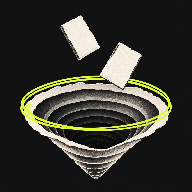
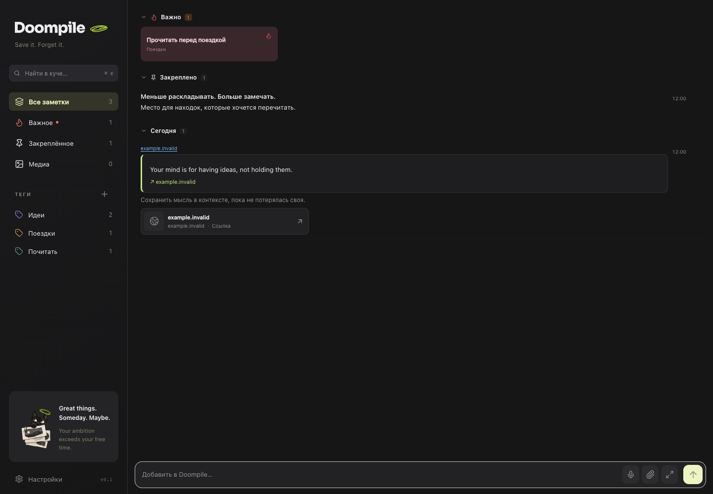

  
  <h1>Doompile</h1>
  
<strong>Save it. Forget it.</strong>

  
Заметки для мыслей, ссылок, цитат и всего, что хочется сохранить на потом.

  
Проект с открытым исходным кодом под <a href="LICENSE">лицензией MIT</a>.

  
<a href="https://grudin.me/doompile"><strong>Открыть облачный Doompile</strong></a> · <a href="docs/get-started.md#свой-сервер"><strong>Развернуть у себя</strong></a>

## Сохрани, пока не забыл

- **Запиши на ходу.** Быстрый ввод как в чате, голосовые заметки и локальные черновики.
- **Забери из браузера.** Web Clipper сохраняет ссылку, выделенную цитату и твой комментарий.
- **Вернись, когда понадобится.** Найди заметку по тексту или тегу и дополни её в редакторе с чеклистами, ссылками и файлами. Коллекция синхронизируется между вебом, iPhone и Mac.

## Как начать

### Облачный Doompile

Открой готовый сервис в браузере, войди и сохрани первую заметку. Приложения и Web Clipper подключаются к той же коллекции.

[Открыть веб-версию](https://grudin.me/doompile) · [Клиенты и расширения](docs/get-started.md#клиенты)

### Свой сервер

Собери Doompile из этого репозитория и запусти его вместе с приватным хранилищем файлов через Docker Compose. Подключи свой домен и вход через Яндекс или Google. Заметки и вложения будут храниться на твоей инфраструктуре.

[Инструкция для своего сервера](docs/get-started.md#свой-сервер)

### Попробовать локально

С установленным [mise](https://mise.jdx.dev/) можно открыть тестовую коллекцию на своём компьютере.

~~~sh
git clone https://github.com/hammersmithg1/doompile.git
cd doompile
mise install
mise exec -- npm ci
DOOMPILE_STORAGE=filesystem DOOMPILE_DEV_LOGIN=1 \
  mise exec -- npm run dev -- --hostname 127.0.0.1
~~~

Открой [localhost:3000](http://localhost:3000) и выбери **Локальный тестовый аккаунт**.

## Документация

- [Быстрый старт и подключение клиентов](docs/get-started.md)
- [Настройка аккаунтов, OAuth и хранилища](docs/authentication.md)
- [Обновления сервера и резервные копии](docs/server-operations.md)
- [Архитектура и разработка](docs/architecture.md)

Лицензии сторонних ресурсов приведены рядом с исходниками. [Шрифт Sora](packages/design/fonts/OFL.txt) · [Иконки Lucide](packages/design/ICONS-LICENSE.txt)
