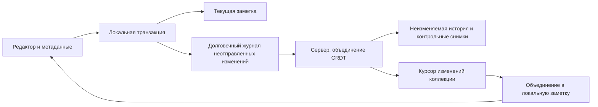

# Синхронизация и история заметки

Статус: аудит и целевая архитектура, 17 ноября 2026. Это описание не означает,
что новая схема уже работает в production.

Требование: одна заметка с постоянным ID на всех устройствах; долговечное
редактирование без сети; автоматическое слияние после подключения; история,
из которой можно просмотреть и восстановить прежнее содержимое. Создание
отдельных конфликтных заметок не является допустимым разрешением конфликта.

## Результат аудита

| Наблюдение | Следствие |
| --- | --- |
| Серверный `NoteStore.save` заменяет `notes.payload` целиком. Старое значение не сохраняется. | `revision` — счётчик конкурентной записи, а не история. Предыдущую редакцию нельзя восстановить через API. |
| Сервер сравнивает `baseRevision` с текущим номером и возвращает 409. | Он обнаруживает расхождение, но не умеет объединять правки. |
| `LocalNotes.conflict` и нативный `Storage.conflict` создают новый UUID. | Дублирование заложено в протокол, а не является исключительно ошибкой автосохранения. |
| Веб `acknowledge` и нативный `accept` продвигают номер ревизии более свежего локального снимка. | Без общего контекста изменений такой приём недостаточен для настоящего слияния текста с другого устройства. |
| Очередь хранит преимущественно последний изменённый снимок заметки. | Промежуточные сохранения длительной офлайн-сессии не образуют восстанавливаемую историю. |
| Получение изменений пропускает грязную локальную запись. | Защищает локальный текст от немедленного затирания, но оставляет устройства на разных ветках до следующей конфликтной записи. |
| Полная коллекция регулярно запрашивается заново. | С ростом заметок и синхронизируемого состояния растут трафик и работа декодирования. |
| API не предоставляет список версий, просмотр или восстановление. | Даже сохранённые где-либо резервные копии не дают пользователю обычную историю заметки. |

Предыдущий кандидат исправляет самоконфликт и продолжение работы с созданной
копией. Он не выполняет новое требование. Его нельзя выпускать как завершённую
реализацию синхронизации без копий.

## Что подтверждено первичными источниками

[Notion описывает](https://www.notion.com/blog/how-we-made-notion-available-offline)
переход от SQLite-кэша к долговечному локальному хранилищу и CRDT для офлайн-правок.
Отслеживание обновлений позволяет не загружать неизменившиеся страницы заново.
Детали их собственного CRDT в этой статье не раскрываются; делать вывод, что
Notion использует именно Yjs, нельзя.

В [пользовательской документации Notion](https://www.notion.com/help/guides/working-offline-in-notion-everything-you-need-to-know)
автоматическое слияние текста отличается от возможного дополнительного разбора
нетекстовых изменений. [История версий](https://www.notion.com/help/duplicate-delete-and-restore-content)
позволяет просмотреть и восстановить прошлое состояние; это отдельная функция,
а не побочный эффект счётчика версий.

Точный алгоритм Apple Notes не подтверждён проверенными публичными материалами
Apple. [CloudKit возвращает локальную, серверную и исходную записи](https://developer.apple.com/documentation/cloudkit/ckerror/serverrecordchanged.md)
при конфликте и требует, чтобы приложение выполнило слияние и повторило запись.
[Пример CKSyncEngine от Apple](https://github.com/apple/sample-cloudkit-sync-engine)
демонстрирует локальное хранение, синхронизацию и тесты нескольких устройств.
Это не исходники Notes и не свидетельство их конкретного алгоритма слияния.

Для нашего Tiptap подходит [Yjs](https://docs.yjs.dev/api/document-updates):
его бинарные обновления допускают повторную доставку и разный порядок получения.
[Официальная интеграция Tiptap](https://tiptap.dev/docs/editor/extensions/functionality/collaboration)
связывает CRDT с редактором и заменяет обычную историю undo/redo. Обычные JSON-снимки
нельзя использовать вместо причинного состояния документа. Также нельзя давать
редактору удалять неизвестные блоки из общего документа при несовпадении схем.

## Целевая схема

1. **Идентичность.** UUID заметки сохраняется при синхронизации, слиянии и
   восстановлении. Другая заметка появляется только при явном действии создания
   или дублирования.
2. **Единое ядро.** Один формат CRDT и одна реализация для веба, сервера и
   встроенного редактора Apple-клиентов. Нативное сохранение вне открытого
   редактора использует то же ядро через JavaScriptCore, а не отдельный Swift-merge.
3. **Локальная долговечность.** Снимок и новые изменения записываются одной
   транзакцией IndexedDB/SQLite. Сбой или перезапуск не очищает очередь.
4. **Подтверждение.** Сервер подтверждает конкретные изменения после фиксации
   транзакции. Подтверждение старой отправки не удаляет новые записи очереди.
   Потерянный ответ приводит к безопасному повтору.
5. **Слияние.** Текст объединяется на уровне CRDT-операций. Разные поля метаданных,
   добавления тегов и вложений не перетирают всю заметку. Устаревшая ревизия не
   превращается в команду создания копии.
6. **Живой редактор.** Входящие изменения применяются к его CRDT, сохраняя локальный
   ввод и позиции. Замена всего документа через `setContent` не является слиянием.
7. **История.** Сервер сохраняет сжатые дельты и периодические контрольные снимки,
   а не полный JSON после каждой клавиши. Медиа хранится по неизменяемым ссылкам
   и не дублируется с каждой версией. Офлайн-журнал доставляет промежуточные
   локальные сохранения, а не только последний результат сессии.
   Исходные операции и причинный снимок сохранения хранятся отдельно от результата
   серверного объединения. Иначе удаление родительского блока и сборка мусора CRDT
   могут сделать параллельный ввод недоступным даже в истории. История должна
   позволять открыть как общий результат, так и исходный сохранённый вариант.
8. **Восстановление.** Просмотр старой версии ничего не меняет. Восстановление
   создаёт новую запись истории в той же заметке; существующая история сохраняется.
9. **Получение изменений.** Долговечный курсор коллекции и порционное получение
   изменившихся заметок. Курсор продвигается вместе с применением данных.
10. **Удаление.** Удаление — синхронизируемое состояние, не физическая потеря
    истории. Старое офлайн-устройство не должно случайно воскрешать удалённую
    заметку своим устаревшим полным снимком.

История хранится без автоматического срока удаления. Группировка близких
автосохранений в интерфейсе не удаляет лежащие под ней изменения. Непримиримые
пользовательские намерения — например удаление и параллельное редактирование
одного фрагмента — получают детерминированное состояние и восстанавливаемую
историю, а не обещание угадать намерение пользователя.

## Переход со старого протокола

- Зафиксировать и проверить резервную копию. Добавить таблицы и поля, сохранив
  существующие ID, пути клиентов, локальные файлы и исходные резервные JSON.
- Текущее содержимое каждой существующей заметки становится начальной версией.
  Версии, которые прежняя система не хранила, нельзя задним числом восстановить.
- Не создавать на разных устройствах независимые CRDT-истории из одного и того
  же JSON. Существующая заметка получает один общий исходный документ.
- Отдельно обработать несинхронизированные старые снимки: сохранить их в истории
  до любого объединения. Не удалять существующие конфликтные заметки автоматически.
- Старый клиент не должен получить ответ, запускающий создание конфликтной копии.
  Несовместимая запись остаётся локально до обновления клиента; чтение и вход
  сохраняют совместимость в пределах проверенного контракта.
- Проверить чтение после восстановления backup вместе с историей и файлами.

## Приёмочные проверки

Два и три устройства: раздельные и одновременные правки одной строки; вставка и
удаление рядом; форматирование, списки, таблицы и неизвестные блоки; метаданные и
медиа; создание офлайн; перезапуск с очередью; обрыв связи до и после server commit;
повторы, перестановка и пакетная доставка; редактирование во время отправки и
получения; длительная офлайн-сессия с несколькими сохранениями; удаление и
восстановление; смена аккаунта; обновление старой базы; просмотр и восстановление
истории; восстановление серверного backup.

На всех устройствах в итоге один ID заметки и одинаковое причинное состояние.
В истории доступны подтверждённые локальные сохранения. Доказательство включает
сквозные тесты реальных клиентов и просмотр захватов интерфейса на каждой
затронутой платформе; чистые тесты merge-функции этого не заменяют.

## Состояние реализации

Реализация подключена в рабочей ветке, выпуск ещё не выполнен. Протокол 2
использует общее Yjs-ядро, транзакционные журналы IndexedDB/SQLite, подтверждения
конкретных изменений и порционный курсор коллекции. Предпросмотр истории и
восстановление добавлены в веб, iOS и macOS. Share, Action и Safari Extensions
получают тот же модуль синхронизации.

Профильные проверки включают три офлайн-ветки с разным порядком и повторами
доставки; сохранение исходного текста при параллельном удалении абзаца;
восстановление из backup; перенос старых подписей и запись старого образа
приложения после rollback. Прогон двух браузерных клиентов проверяет офлайн-ввод,
перезагрузку, объединение, историю и восстановление одного ID в Chromium и WebKit.
Удаление блока вложения и Undo сохраняют правильный список файлов и метаданные.
На тесте 1001 версии вся SQLite-база занимает около 1,7 МБ, против 17,3 МБ
сжатых полных снимков; сами сжатые блоки истории занимают около 0,4 МБ.

Перед выпуском остаются обязательными полные проверки, нативные UI-сценарии
и просмотр захватов каждой поверхности. История с сервера требует соединения;
уже загруженные заметки и неотправленный журнал доступны локально. Новый браузер
или устройство сначала должны войти и загрузить коллекцию. Добавление вложений
через существующий веб-редактор требует сети; нативные клиенты и очередь быстрого
захвата сохраняют ожидающие отправки файлы локально.
